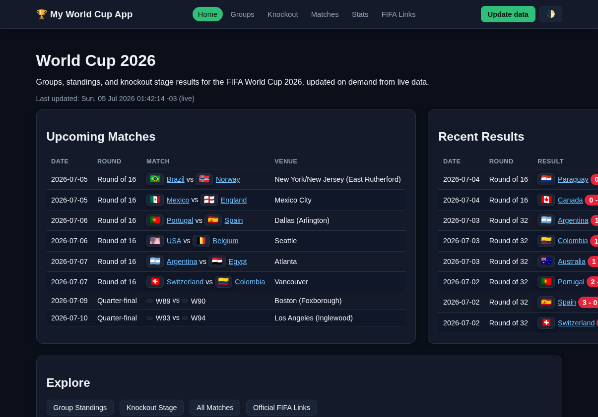
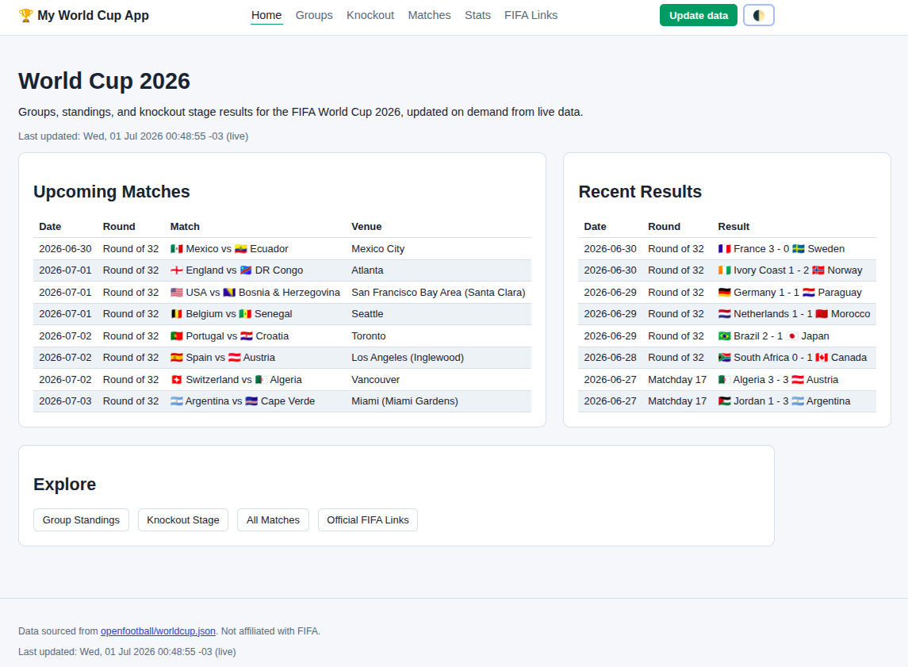
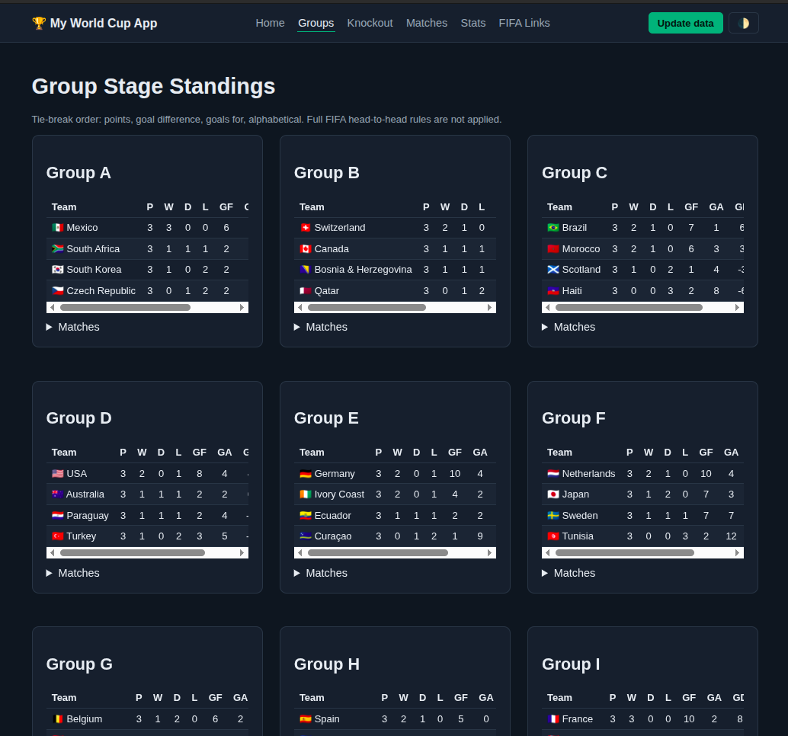
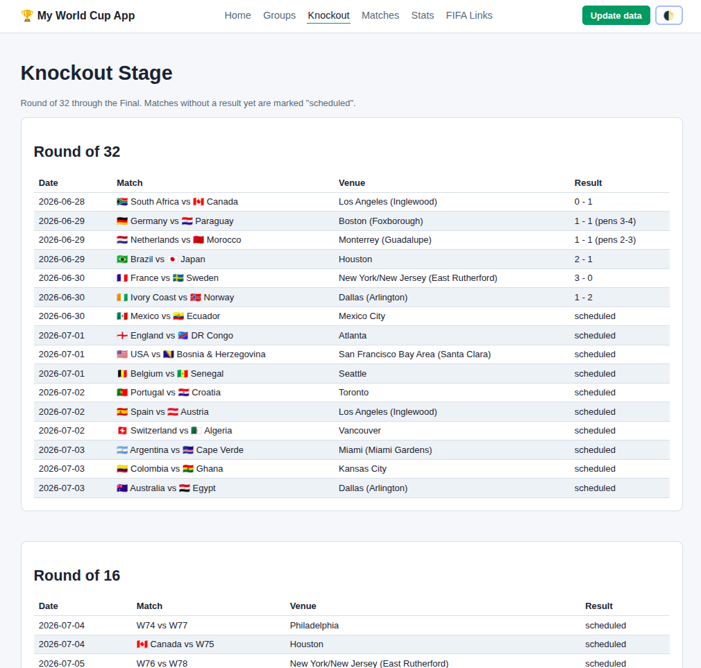
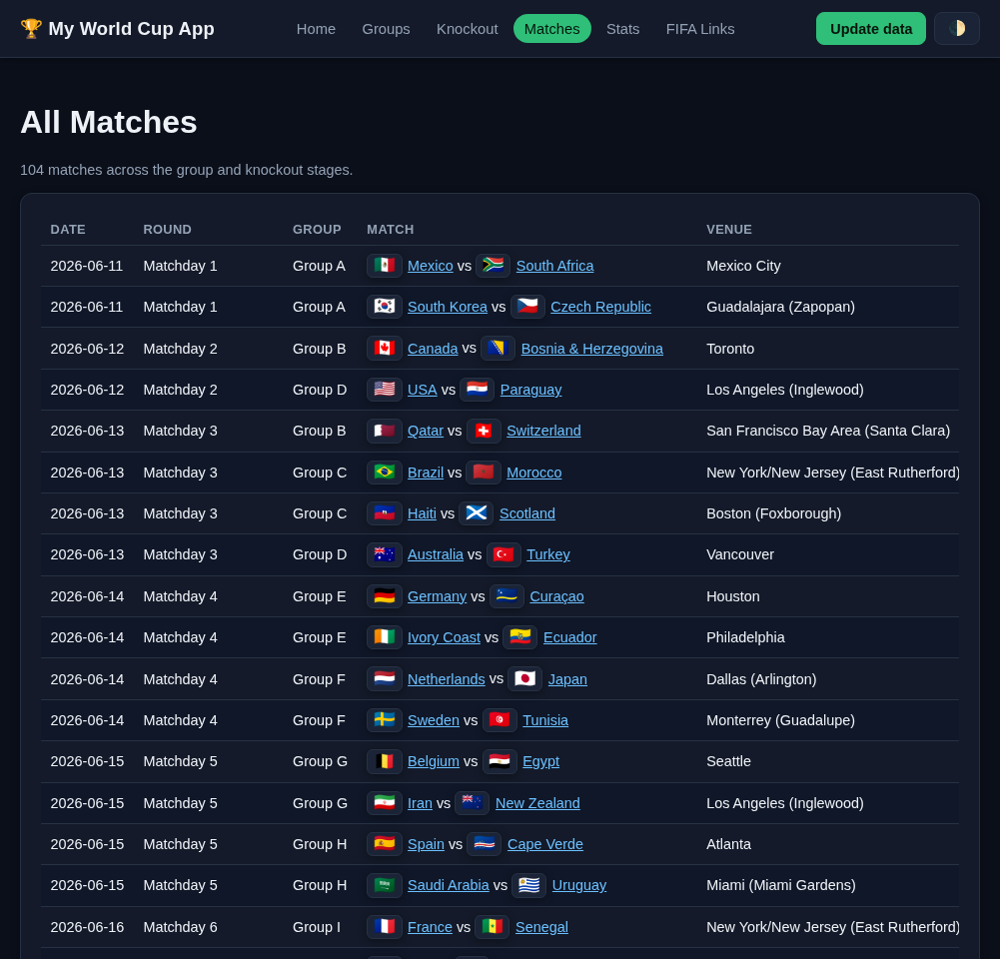
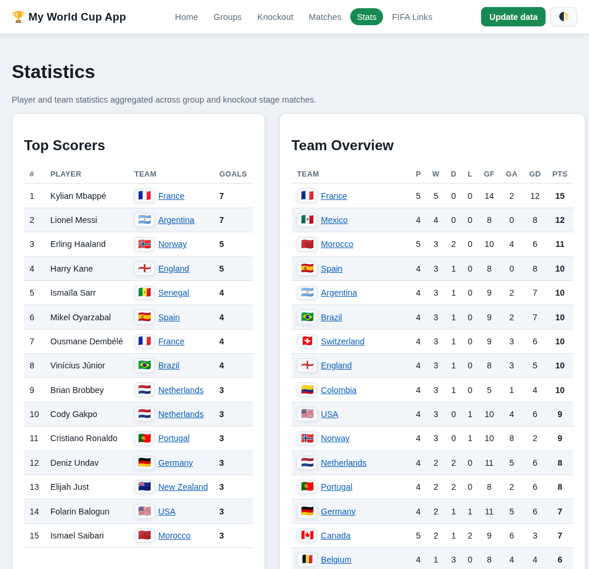
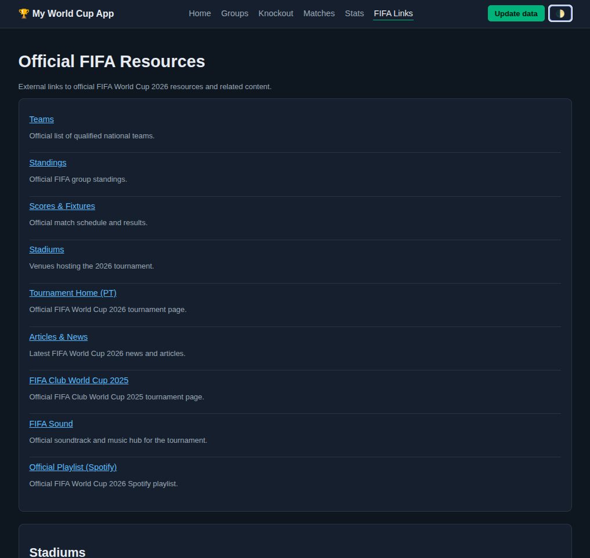
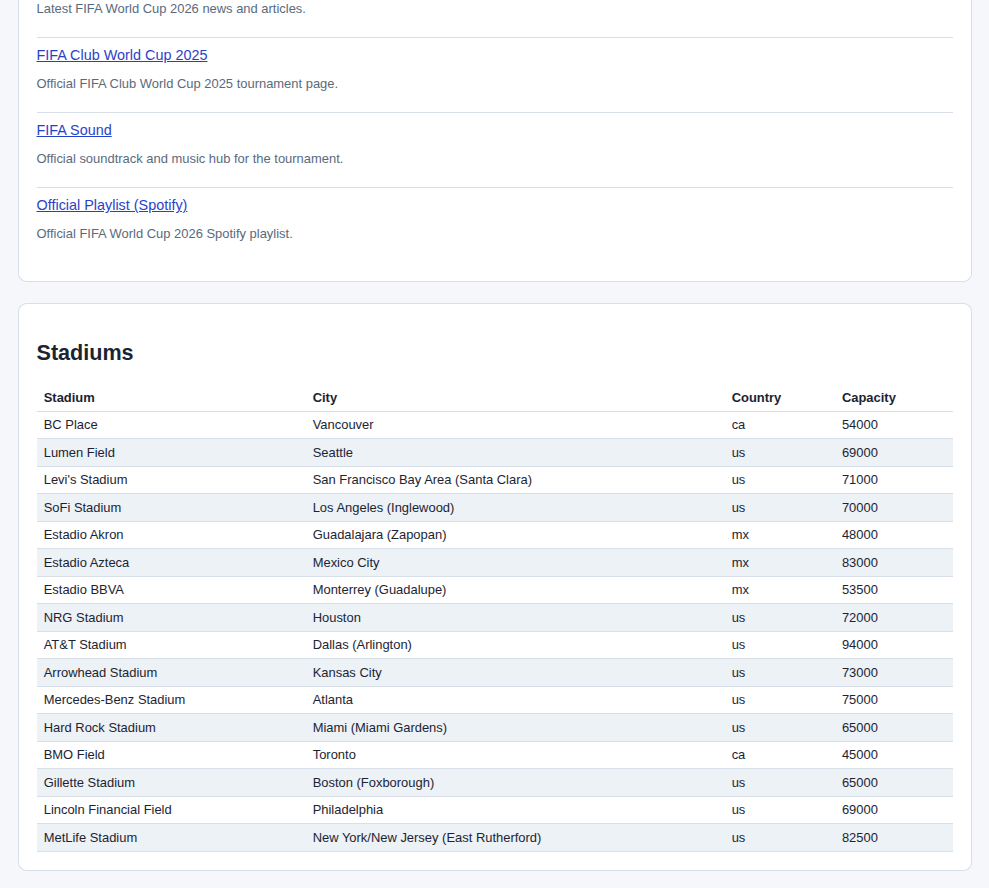
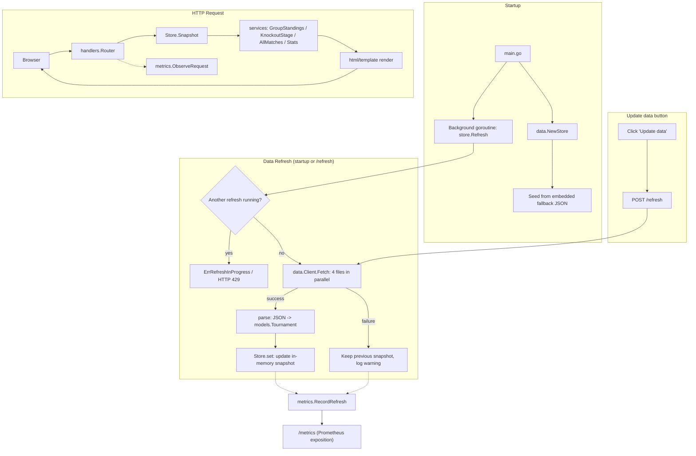

<!-- TOC -->

- [My World Cup App](#my-world-cup-app)
  - [Features](#features)
  - [Documentation](#documentation)
  - [Screenshots](#screenshots)
  - [Getting Started](#getting-started)
    - [Software Requirements](#software-requirements)
    - [Makefile Targets](#makefile-targets)
    - [Run locally](#run-locally)
    - [Run tests](#run-tests)
    - [Build a binary](#build-a-binary)
    - [Run with Docker](#run-with-docker)
      - [Multi-arch image (linux/amd64 + linux/arm64)](#multi-arch-image-linuxamd64--linuxarm64)
    - [Run with the observability stack (Grafana, Prometheus, Loki, Tempo, Jaeger)](#run-with-the-observability-stack-grafana-prometheus-loki-tempo-jaeger)
    - [Run with Helm](#run-with-helm)
      - [Deploying to a local kind cluster](#deploying-to-a-local-kind-cluster)
    - [Configuration](#configuration)
  - [Technology Stack](#technology-stack)
  - [Architecture](#architecture)
    - [Data flow](#data-flow)
    - [Request routing](#request-routing)
  - [Directory Structure](#directory-structure)
  - [Data Refresh Behavior](#data-refresh-behavior)
  - [Standings Calculation](#standings-calculation)
  - [Observability](#observability)
    - [Health checks](#health-checks)
    - [Logs](#logs)
    - [Metrics](#metrics)
    - [Traces](#traces)
  - [Testing](#testing)
  - [Contributing](#contributing)
  - [Developer](#developer)
  - [License](#license)

<!-- TOC -->

# My World Cup App

A lightweight Go web application that displays the FIFA World Cup 2026 (Canada/Mexico/USA) group standings, match results, and knockout stage, plus curated links to official FIFA resources. Data is fetched live on startup and on demand, with no database required.

## Features

- **Group standings** — computed on the fly from match results (played, won, drawn, lost, goals, goal difference, points).
- **Knockout stage** — a graphical bracket (Round of 32 through the Final, plus the match for third place) with connector lines and winner highlighting, alongside round-by-round detail tables with date/venue/result.
- **Match list** — every fixture with date, round, group, venue, and result, filterable by round, group, and/or team via query parameters (combinable).
- **Live data refresh** — data is fetched from [openfootball/worldcup.json](https://github.com/openfootball/worldcup.json) on startup and via the "Update data" button; an embedded snapshot is used as a fallback if the live source is unreachable.
- **Statistics** — top scorers and overall team records (played/won/drawn/lost/goals/points) aggregated across group and knockout stage matches.
- **Dark / light theme** — toggle persisted in the browser via `localStorage`.
- **Official FIFA links** — stadiums, teams, standings, articles, scores & fixtures, official match ball, posters, mascots, Club World Cup 2025, and the official FIFA Sound playlist; team names, stadiums, and host cities across the app link to their official fifa.com pages.
- **Observability** — liveness (`/healthz`) and readiness (`/readyz`) probes, structured JSON logs carrying trace IDs, a Prometheus `/metrics` endpoint with trace exemplars, and opt-in OpenTelemetry tracing. `make observability-up` starts a local Grafana + Prometheus + Loki + Tempo + Jaeger stack with ready-made dashboards that link metrics, logs, and traces together.

## Documentation

- [`docs/`](docs/README.md) — a beginner-friendly guide to how the app works (architecture, data flow, request lifecycle, football rules, observability, deployment, developer workflow), with analogies and Mermaid diagrams.
- [`REQUIREMENTS.md`](REQUIREMENTS.md) — supported platforms and every tool to install (with pinned versions).
- [`CONTRIBUTING.md`](CONTRIBUTING.md) — the fork/branch/PR workflow.
- [`CHANGELOG.md`](CHANGELOG.md) — release history.

## Screenshots

<table>
  <tr>
    <td align="center" width="50%">
      <a href="images/a.png"></a>
      <br><sub>Home — dark theme</sub>
    </td>
    <td align="center" width="50%">
      <a href="images/b.png"></a>
      <br><sub>Home — light theme</sub>
    </td>
  </tr>
  <tr>
    <td align="center" width="50%">
      <a href="images/c.png"></a>
      <br><sub>Group Standings — dark theme</sub>
    </td>
    <td align="center" width="50%">
      <a href="images/d.png"></a>
      <br><sub>Knockout Stage — light theme</sub>
    </td>
  </tr>
  <tr>
    <td align="center" width="50%">
      <a href="images/e.png"></a>
      <br><sub>All Matches — dark theme</sub>
    </td>
    <td align="center" width="50%">
      <a href="images/f.png"></a>
      <br><sub>Statistics (top scorers &amp; team overview) — light theme</sub>
    </td>
  </tr>
  <tr>
    <td align="center" width="50%">
      <a href="images/g.png"></a>
      <br><sub>Official FIFA Links — dark theme</sub>
    </td>
    <td align="center" width="50%">
      <a href="images/h.png"></a>
      <br><sub>FIFA Links &amp; Stadiums — light theme</sub>
    </td>
  </tr>
</table>

## Getting Started

### Software Requirements

Supported development platforms: **Ubuntu 22.04 / 24.04 / 26.04 (amd64)** and **macOS (amd64 / arm64)**. The toolchain is pinned in [`mise.toml`](mise.toml) and installed by [mise](https://mise.jdx.dev); Docker is installed separately. Full details, per-OS instructions and troubleshooting: **[REQUIREMENTS.md](REQUIREMENTS.md)**.

| Tool | Version | Installed by | Required For |
|------|---------|--------------|--------------|
| [Git](https://git-scm.com/downloads), [Make](https://www.gnu.org/software/make/), curl | any | `make install-deps` (apt / Xcode CLT) | Cloning, Makefile shortcuts, installing mise |
| [mise](https://mise.jdx.dev) | latest | `make install-deps` | Installing/pinning the tools below |
| [Go](https://go.dev/) | 1.27.4 | mise | Building/running/testing locally |
| [golangci-lint](https://golangci-lint.run/) | 2.15.0 | mise | `make lint` / `make check` |
| [Helm](https://helm.sh/) | **4.3.2 (Helm 4 required; Helm 3 is not supported)** | mise | Linting/rendering/installing the Helm chart |
| [helm-docs](https://github.com/norwoodj/helm-docs) | 1.14.2 | mise | Regenerating `helm/my-world-cup-app/README.md` |
| [kind](https://kind.sigs.k8s.io/) | 0.33.0 | mise | Local Kubernetes cluster (`make kind-load`) |
| [kubectl](https://kubernetes.io/docs/reference/kubectl/) | 1.36.2 | mise | Interacting with the cluster |
| [Docker](https://docs.docker.com/get-docker/) | 24+ | **you** (see REQUIREMENTS.md) | Building/running the container image |
| [Docker Compose](https://docs.docker.com/compose/install/) | v2 (plugin) | **you** | `make docker-up` / `docker-down` / `docker-logs` |
| [Docker Buildx](https://docs.docker.com/build/concepts/overview/#install-buildx) | v0.10+ | **you** | `make docker-build-multiarch`, `make docker-push` |

```bash
make install-deps   # install base packages, mise, and the pinned toolchain
make check-deps     # verify everything (including Docker) is installed
```

Every `Makefile` target runs the toolchain through `mise exec`, so the pinned versions are used even if mise isn't activated in your shell.

See also [CONTRIBUTING.md](CONTRIBUTING.md) for the contribution workflow.

### Makefile Targets

Run `make help` (or just `make`, since `help` is the default goal) to print this list from the terminal.

| Target                | Description                                                                  |
|------------------------|--------------------------------------------------------------------------------|
| `make help`            | Show the list of available targets                                           |
| `make check-deps`      | Check that every required tool (base packages, mise-pinned toolchain, Docker) is installed |
| `make install-deps`    | Install base packages, mise, and the toolchain pinned in `mise.toml` (Docker is installed separately) |
| `make run`             | Run the application locally                                                  |
| `make build`           | Build the server binary into `bin/`                                          |
| `make test`            | Run all tests                                                                |
| `make test-coverage`   | Run tests with a coverage report                                             |
| `make fmt`             | Format source code                                                           |
| `make fmt-check`       | Check source code formatting                                                 |
| `make vet`             | Run `go vet`                                                                 |
| `make lint`            | Run golangci-lint (config: `app/.golangci.yml`, includes the `modernize` analyzer) |
| `make tidy`            | Tidy `go.mod`/`go.sum`                                                       |
| `make check`           | Run formatting, vet, lint, and tests (`fmt-check` + `vet` + `lint` + `test`) |
| `make docker-build`    | Build the Docker image (tagged with the `VERSION` file's version)            |
| `make docker-up`       | Start the application via Docker Compose                                     |
| `make docker-down`     | Stop and remove the Docker Compose services                                  |
| `make docker-logs`     | Tail the application container logs                                          |
| `make observability-up` | Start the app plus the observability stack (Grafana, Prometheus, Loki, Tempo, Jaeger, Alloy) via Docker Compose |
| `make observability-down` | Stop the app and observability stack (add `VOLUMES=1` to also delete stored metrics/logs/traces) |
| `make observability-logs` | Tail the logs of every container in the observability stack               |
| `make observability-validate` | Validate the observability Compose file, Alloy/Prometheus/Loki/Tempo configs, and Grafana dashboard JSON (needs Docker) |
| `make docker-buildx-setup` | Create (or reuse) the Docker Buildx builder used for multi-arch images   |
| `make docker-build-multiarch` | Build a multi-arch image (linux/amd64 + linux/arm64, runs on Linux and macOS/Intel+Apple Silicon) without pushing, to validate the build for both platforms |
| `make docker-push`     | Build and push a multi-arch image (linux/amd64 + linux/arm64); interactively prompts for registry username, password/token, and repository name |
| `make kind-load`       | Load the local Docker image into the kind cluster (`KIND_CLUSTER`, default `kind-multinodes`) |
| `make helm-sync-version` | Write the `VERSION` file's version into the Helm chart's `appVersion` (`helm/my-world-cup-app/Chart.yaml`) |
| `make helm-lint`       | Lint the Helm chart (Helm 4)                                                 |
| `make helm-template`   | Render the Helm chart locally, including the optional ingress/HPA templates  |
| `make helm-docs`       | Sync `appVersion` from `VERSION`, then regenerate the Helm chart README (`helm/*/README.md`) via helm-docs |
| `make helm-install`    | Install/upgrade the app into Kubernetes via Helm 4 (namespace: `NAMESPACE`, default app name) |
| `make helm-uninstall`  | Uninstall the Helm release from Kubernetes                                   |
| `make clean`           | Remove build artifacts                                                       |

### Run locally

```bash
make run
# or, with mise activated in your shell
PORT=8080 go -C app run ./cmd/server
```

Then open http://localhost:8080.

### Run tests

```bash
make test              # go test ./... -v
make test-coverage     # with coverage report
make lint              # golangci-lint
make check             # fmt-check + vet + lint + test (run before every commit)
```

### Build a binary

```bash
make build              # outputs bin/my-world-cup-app
```

### Run with Docker

```bash
make docker-build       # docker compose build
make docker-up          # docker compose up -d --build
make docker-logs        # tail logs
make docker-down        # stop and remove
```

The container serves the app on `PORT` (default `8080`), mapped to the host via `docker-compose.yml`.

#### Multi-arch image (linux/amd64 + linux/arm64)

`Dockerfile` builds a static, CGO-free binary (the builder stage runs on the build host's native platform and cross-compiles via `TARGETOS`/`TARGETARCH`, so no QEMU emulation is needed), so the same build works unmodified on both `linux/amd64` and `linux/arm64` — covering Linux servers and macOS (both Intel and Apple Silicon, since Docker Desktop always runs Linux containers matching the host architecture) via [Docker Buildx](https://docs.docker.com/build/architecture/#buildx):

```bash
make docker-build-multiarch    # build for linux/amd64 + linux/arm64 (validates only; multi-platform results can't be loaded into the local daemon)
make docker-push               # build + push a multi-arch manifest to a registry
```

`make docker-push` interactively prompts for:

1. **Docker registry username**
2. **Docker registry password or access token** (hidden input, piped to `docker login --password-stdin` — never passed as a CLI argument or left in shell history)
3. **Repository name**, e.g. `docker.io/<user>/my-world-cup-app` or `ghcr.io/<user>/my-world-cup-app` (the registry host is inferred from this to log in against the right registry; omit a host to default to Docker Hub)
4. **Image tag** (defaults to the version in the root [`VERSION`](VERSION) file if left blank)

`make docker-push` also runs `make helm-sync-version` first, so `helm/my-world-cup-app/Chart.yaml`'s `appVersion` always matches the `VERSION` file before an image is published. Override the target platform list with `DOCKER_PLATFORMS` (default `linux/amd64,linux/arm64`), e.g. `make docker-push DOCKER_PLATFORMS=linux/amd64`.

Every image is also labeled `org.opencontainers.image.version` with the tag actually used (`docker inspect <image> --format '{{.Config.Labels}}'` to check), baked in via the Dockerfile's `APP_VERSION` build-arg.

### Run with the observability stack (Grafana, Prometheus, Loki, Tempo, Jaeger)

`docker-compose.observability.yml` layers a complete local observability stack on top of `docker-compose.yml`. Every image is pinned to its latest release at the time of writing; configuration lives in [`observability/`](observability/).

```bash
make observability-up         # app + stack; prints the URLs below
make observability-validate   # check every config file with the tools themselves (no stack needed)
make observability-down       # stop (VOLUMES=1 also deletes the stored data)
```

| Component | Version | URL (bound to `127.0.0.1`) | Role |
|-----------|---------|------------------------------|------|
| [Grafana](https://grafana.com/oss/grafana/) | 13.3.1 | http://localhost:3000 | Dashboards + Explore; anonymous Admin, no login (local use only) |
| [Prometheus](https://prometheus.io/) | 3.16.0 | http://localhost:9090 | Scrapes the app's `/metrics` (with exemplars); receives Tempo's span metrics |
| [Loki](https://grafana.com/oss/loki/) | 3.7.10 | http://localhost:3100 | Stores the containers' JSON logs |
| [Tempo](https://grafana.com/oss/tempo/) | 3.1.1 | http://localhost:3200 | Stores traces; derives span metrics and the service graph |
| [Jaeger](https://www.jaegertracing.io/) | 2.23.0 | http://localhost:16686 | Second trace backend with its own UI |
| [Grafana Alloy](https://grafana.com/oss/alloy/) | 1.22.0 | http://localhost:12345 | Collector: OTLP traces → Tempo + Jaeger; Docker logs → Loki |

If a port is already taken on your machine, override it: `make observability-up GRAFANA_PORT=13000 JAEGER_PORT=26686` (also `PROMETHEUS_PORT`, `LOKI_PORT`, `TEMPO_PORT`, `ALLOY_PORT`; use the same variables with `observability-down`).

Grafana is provisioned with the four data sources (cross-linked: exemplar → trace, log line → trace, span → logs/metrics) and three dashboards in the **My World Cup App** folder:

- **Metrics** — request rate, 5xx ratio, latency percentiles with clickable trace exemplars, per-route traffic, data-refresh health, and Tempo-derived span metrics.
- **Logs** — log volume by level, HTTP status and p95 duration computed from the JSON access log, the app's log stream (each line links to its trace in Tempo or Jaeger), warnings/errors, and the stack's own logs.
- **Traces** — RED metrics from spans, the service graph, and TraceQL tables of recent, slow, failed, and data-refresh traces.

> Jaeger 2.21+ removed the legacy HTTP API that Grafana's bundled Jaeger plugin uses for *searching*; the stack enables Grafana's `jaegerEnableGrpcEndpoint` feature toggle so the data source works against Jaeger's `/api/v3`, and trace lookup by ID works, but trace search lives in the Jaeger UI.

See [docs/07-observability.md](docs/07-observability.md) for a guided tour.

### Run with Helm

A Helm chart is provided at `helm/my-world-cup-app` for Kubernetes deployment. It requires **Helm 4** — rendering it with Helm 3 fails with an explicit `requires Helm 4` error.

```bash
make helm-lint       # helm lint (default values + optional templates enabled)
make helm-template   # render manifests locally
helm upgrade --install my-world-cup-app helm/my-world-cup-app --set image.repository=<your-registry>/my-world-cup-app --set image.tag=<tag>
```

The chart deploys a single `Deployment` + `Service` (ClusterIP by default), wires `/healthz` as the startup/liveness probe and `/readyz` as the readiness probe (with `SHUTDOWN_DRAIN_DELAY=5s` so a terminating pod leaves the Service before closing connections), and pre-populates `prometheus.io/scrape`, `prometheus.io/port`, and `prometheus.io/path` pod annotations so a cluster Prometheus can auto-discover `/metrics`. Ingress and HPA are included but disabled by default (`ingress.enabled` / `autoscaling.enabled` in `values.yaml`). Pods run as the non-root distroless user (UID 65532) with a `RuntimeDefault` seccomp profile, a read-only root filesystem, all capabilities dropped, and no ServiceAccount token mounted. See the generated [chart README](helm/my-world-cup-app/README.md) for every value.

#### Deploying to a local kind cluster

Since a local kind cluster can't pull an image that only exists in your local Docker daemon, load it in first:

```bash
make kind-load                 # docker-build, then `kind load docker-image` into KIND_CLUSTER (default kind-multinodes)
make helm-install               # installs/upgrades using the image tagged with the VERSION file's version
```

Override the target cluster with `make kind-load KIND_CLUSTER=<cluster-name>` if yours isn't named `kind-multinodes`.

### Configuration

All configuration is via environment variables (see `app/internal/config/config.go`). There are no required variables — every one of them has a working default.

| Variable                | Default                                            | Description                |
|--------------------------|-----------------------------------------------------|------------------------------|
| `PORT`                   | `8080`                                              | HTTP listen port            |
| `FETCH_TIMEOUT`          | `10s`                                               | Max duration of one data refresh (Go duration syntax, e.g. `15s`, `1m`); invalid or non-positive values fall back to the default |
| `LOG_FORMAT`             | `json`                                              | `json` (one JSON object per line, for log collectors) or `text` (logfmt-style, easier to read in a terminal); unknown values fall back to `json` |
| `SHUTDOWN_DRAIN_DELAY`   | `0s` (disabled)                                     | After SIGTERM, keep serving this long while `/readyz` answers `503`, so a load balancer stops routing here before connections close (the Helm chart sets `5s`) |
| `OTEL_EXPORTER_OTLP_ENDPOINT` | unset (tracing off)                            | OTLP/HTTP collector base URL (e.g. `http://alloy:4318`); setting it (or `OTEL_EXPORTER_OTLP_TRACES_ENDPOINT`) turns tracing on |
| `OTEL_SERVICE_NAME`      | `my-world-cup-app`                                  | Trace `service.name`. All other standard [OpenTelemetry SDK variables](https://opentelemetry.io/docs/specs/otel/configuration/sdk-environment-variables/) apply too (`OTEL_TRACES_SAMPLER`, `OTEL_RESOURCE_ATTRIBUTES`, `OTEL_EXPORTER_OTLP_HEADERS`, `OTEL_SDK_DISABLED`, ...) |
| `WORLDCUP_MATCHES_URL`   | openfootball `2026/worldcup.json`                   | Match data source            |
| `WORLDCUP_GROUPS_URL`    | openfootball `2026/worldcup.groups.json`            | Group assignments source     |
| `WORLDCUP_TEAMS_URL`     | openfootball `2026/worldcup.teams.json`             | Team metadata source          |
| `WORLDCUP_STADIUMS_URL`  | openfootball `2026/worldcup.stadiums.json`          | Stadium data source           |

## Technology Stack

- [Go](https://go.dev/) 1.27 — standard library for the web layer (`net/http`, `html/template`, `encoding/json`, `embed`); no web framework.
- [prometheus/client_golang](https://github.com/prometheus/client_golang) (`/metrics`, `app/internal/metrics`) and [OpenTelemetry Go](https://opentelemetry.io/docs/languages/go/) (tracing: SDK, OTLP/HTTP exporter, `otelhttp`; `app/internal/telemetry`) — the only third-party dependencies, both for observability.
- Local observability stack: Grafana 13, Prometheus 3, Loki 3, Tempo 3, Jaeger 2, and Grafana Alloy (`docker-compose.observability.yml`).
- Vanilla CSS (custom properties for theming) and vanilla JavaScript (no build step, no client framework).
- Docker / Docker Compose for containerized runs; a Helm chart for Kubernetes deployment.
- `go test` for unit and integration tests; [golangci-lint](https://golangci-lint.run/) v2 (with the `modernize` analyzer) for static analysis. Code follows the [JetBrains Modern Go Guidelines](https://github.com/JetBrains/go-modern-guidelines).
- [mise](https://mise.jdx.dev) pins the toolchain (`mise.toml`); [Helm 4](https://helm.sh/) for Kubernetes deployment.

## Architecture

The application follows a clean, layered architecture:

```
app/cmd/server        entrypoint: wiring, HTTP server lifecycle
app/internal/config    environment-driven configuration
app/internal/models    domain types (Team, Group, Match, Stadium, Standing, Tournament)
app/internal/data      HTTP client, JSON parsing/normalization, thread-safe in-memory store
app/internal/services  business logic: group standings, knockout grouping, match/stats queries
app/internal/handlers  HTTP handlers, routing, template rendering
app/internal/metrics   Prometheus instrumentation (HTTP requests, data refresh outcomes)
app/internal/telemetry OpenTelemetry tracing setup and trace-aware JSON logging
app/web/               embedded HTML templates and static assets (CSS/JS)
helm/                   Helm chart for Kubernetes deployment
```

- **Handlers** depend on **services** and the **data store**, never the other way around.
- **Services** are pure functions operating on **models**, independent of HTTP or the data source — easy to unit test.
- **Data** owns fetching, parsing, and caching; it exposes a `Store` with `Snapshot()` (returns a `data.Snapshot`: tournament + last-updated time + source, read atomically) and `Refresh()`.
- No database: the `Store` holds the current `Tournament` in memory behind a `sync.RWMutex`. Standings are recomputed from match results on every request rather than persisted. The snapshot is shared by all requests, so services never sort its slices in place.

### Data flow



### Request routing

| Method | Path        | Handler              | Description                          |
|--------|-------------|-----------------------|---------------------------------------|
| GET    | `/`         | `pages.Home`          | Dashboard: upcoming/recent matches    |
| GET    | `/groups`   | `pages.Groups`        | Group standings and results           |
| GET    | `/knockout` | `pages.Knockout`      | Knockout stage bracket + round detail |
| GET    | `/matches`  | `pages.Matches`       | Match list, filterable by `round`/`group`/`team` query params |
| GET    | `/stats`    | `pages.Stats`         | Top scorers and team statistics       |
| GET    | `/links`    | `pages.Links`         | Official FIFA/Spotify links, stadiums |
| POST   | `/refresh`  | `refresh.Refresh`     | Triggers a live data refresh (`200` ok, `502` upstream failed, `429` + `Retry-After` if a refresh is already running) |
| GET    | `/healthz`  | `healthz`             | Liveness check: `200 ok` while the process can answer (Docker `HEALTHCHECK`, Helm startup/liveness probes) |
| GET    | `/readyz`   | `Health.readyz`       | Readiness check: `200` JSON with the data source in use, `503` once shutdown has started (Helm readiness probe) |
| GET    | `/metrics`  | Prometheus handler    | Prometheus metrics exposition         |
| GET    | `/static/*` | embedded file server  | CSS/JS assets                         |

## Directory Structure

```
my-world-cup-app/
├── app/                          # Go module root — all application source
│   ├── cmd/server/main.go
│   ├── internal/
│   │   ├── config/
│   │   ├── models/
│   │   ├── data/
│   │   │   ├── client.go
│   │   │   ├── fallback.go
│   │   │   ├── fallback/        # embedded snapshot JSON (openfootball 2026 data)
│   │   │   ├── parser.go
│   │   │   └── store.go
│   │   ├── services/            # standings, knockout, matches, stats
│   │   ├── handlers/            # routes, middleware, pages, /refresh, /healthz + /readyz
│   │   ├── metrics/             # Prometheus counters/histograms (+ trace exemplars)
│   │   └── telemetry/           # OpenTelemetry tracing setup, JSON logger with trace IDs
│   ├── web/
│   │   ├── assets.go            # go:embed directives
│   │   ├── templates/
│   │   └── static/{css,js}/
│   ├── .golangci.yml            # golangci-lint v2 configuration
│   ├── go.mod
│   └── go.sum
├── docs/                         # beginner's guide (architecture, data flow, rules, deployment...)
├── helm/my-world-cup-app/      # Helm chart (Helm 4)
├── observability/               # Alloy, Prometheus, Loki, Tempo configs + Grafana provisioning/dashboards
├── scripts/
│   ├── deps.sh                  # `make check-deps` / `make install-deps` implementation
│   └── observability-validate.sh # `make observability-validate` implementation
├── mise.toml                     # pinned toolchain versions
├── Dockerfile
├── docker-compose.yml
├── docker-compose.observability.yml # local Grafana/Prometheus/Loki/Tempo/Jaeger/Alloy stack
├── Makefile
├── VERSION                       # release version; see make helm-sync-version / docker-push
├── README.md
├── REQUIREMENTS.md
├── CHANGELOG.md
├── CONTRIBUTING.md
└── CLAUDE.md
```

## Data Refresh Behavior

1. On startup, the app seeds itself from an **embedded snapshot** of the four openfootball JSON files (bundled at build time via `go:embed`), so it can serve pages immediately.
2. A background goroutine performs an initial **live refresh** against the configured URLs.
3. Clicking **"Update data"** in the UI (or `POST /refresh`) triggers a synchronous live refresh. Only one refresh runs at a time; a concurrent request gets `429 Too Many Requests` with `Retry-After: 5` instead of hitting the upstream again.
4. The four source files are downloaded in parallel, each capped at 10 MiB and bounded by `FETCH_TIMEOUT`. If any fetch or parse fails (network issue, rate limit, etc.), the previous snapshot is kept and the failure is logged — the app never serves a broken or empty page.
5. On shutdown (SIGINT/SIGTERM), `/readyz` starts answering `503`, the server keeps serving for `SHUTDOWN_DRAIN_DELAY` (if set), an in-flight initial refresh is canceled, and in-flight requests get up to 10 seconds to finish. Buffered trace spans are flushed before exit.

## Standings Calculation

Group tables (and the overall team statistics on `/stats`) are computed from played matches using standard football scoring (3 points for a win, 1 for a draw). Ties are broken by: points → goal difference → goals for → alphabetical order. This is a simplified tie-break; it does not implement FIFA's full head-to-head/fair-play rules.

- **Extra time** counts: openfootball's `et` score is cumulative, so `Match.FinalScore()` returns it (falling back to the full-time score), and both standings and `Match.Winner()` use it. A penalty shoot-out decides `Winner()` for a match still level after extra time, but shoot-out kicks are not goals: in the `/stats` team records such a match counts as a draw.
- **Own goals** (`"owngoal": true` in the source) count toward the score but are not credited to the scorer in the top-scorers list (the player belongs to the opposing team).
- Results are rendered with the `result` template func: final score pill, an `a.e.t.` marker, and the shoot-out score when applicable.

See [docs/06-football-rules.md](docs/06-football-rules.md) for a walkthrough with diagrams.

## Observability

The app covers the three observability signals, and ties them together with the trace ID. See [docs/07-observability.md](docs/07-observability.md) for diagrams, and [the observability stack](#run-with-the-observability-stack-grafana-prometheus-loki-tempo-jaeger) to see everything in Grafana locally.

### Health checks

- `GET /healthz` — **liveness**: `200 ok` whenever the process can answer. It checks nothing else on purpose: failing it makes Kubernetes restart the pod.
- `GET /readyz` — **readiness**: `200 {"status":"ready","data_source":"live|fallback","last_updated":...}`, or `503 {"status":"draining",...}` once shutdown starts. It does not fail when openfootball is unreachable — the embedded fallback keeps the app useful, and failing every replica at once would take the site down.
- Neither endpoint is traced, so probes don't flood the trace backends.

### Logs

Logs are structured (`log/slog`) and written to stdout as **JSON by default** (`LOG_FORMAT=text` switches to logfmt-style text). Each request produces one access-log line; lines logged while handling a traced request (or one arriving with a W3C `traceparent` header) carry `trace_id` and `span_id`:

```json
{"time":"2026-11-16T09:45:39.67Z","level":"INFO","msg":"request","method":"GET","path":"/stats","route":"/stats","status":200,"duration_ms":0.9,"trace_id":"f448a12c43a019a26ab99c77134820d1","span_id":"68a87468c4881c30"}
```

| Field | Meaning |
|-------|---------|
| `time`, `level`, `msg` | Timestamp (RFC 3339), `DEBUG`/`INFO`/`WARN`/`ERROR`, event name |
| `method`, `path`, `route`, `status`, `duration_ms` | Access-log fields: `route` is the matched pattern (or `unmatched`), `duration_ms` a float |
| `trace_id`, `span_id` | Correlation with the trace in Tempo/Jaeger (present when a trace context exists) |

In the local stack, Alloy ships these lines to Loki, promoting `level` to a label and keeping `trace_id`/`span_id` as structured metadata, which Grafana turns into "View trace" links.

### Metrics

- `http_requests_total{method,path,status}` — request counts, `status` bucketed as `2xx`/`3xx`/`4xx`/`5xx`. `path` is the matched route pattern (e.g. `/static/`); requests matching no route are recorded as `path="unmatched"` so scanners probing random URLs can't create unbounded label values.
- `http_request_duration_seconds{method,path}` — request latency histogram.
- `data_refresh_total{outcome}` — count of refresh attempts, `outcome` = `success`/`failure` (requests rejected because a refresh was already running are not counted).
- `data_last_refresh_timestamp_seconds` — Unix timestamp of the last successful refresh.

When a request is traced, its `http_*` samples carry the trace ID as an **exemplar**. Exemplars are only exposed in the OpenMetrics format, which Prometheus negotiates automatically; plain-text scrapes are unchanged. Run Prometheus with `--enable-feature=exemplar-storage` to keep them.

### Traces

Tracing uses [OpenTelemetry](https://opentelemetry.io/) and is **off unless `OTEL_EXPORTER_OTLP_ENDPOINT` is set** (no endpoint → a no-op tracer, nothing exported). Spans are exported over OTLP/HTTP to any compatible collector or backend:

- one server span per request, named after the route (`GET /groups`), excluding `/healthz`, `/readyz`, and `/metrics`;
- a `data.Refresh` span per data refresh, with one client span for each of the four parallel openfootball downloads (the trace context is propagated to the upstream via `traceparent`).

The sampler defaults to `parentbased_always_on`; set `OTEL_TRACES_SAMPLER=parentbased_traceidratio` and `OTEL_TRACES_SAMPLER_ARG=0.1` to keep 10 % of traces in busier environments.

## Testing

- `app/internal/data`: JSON parsing/normalization tests, plus store tests covering successful refresh, failed refresh (previous snapshot retained), and fallback seeding.
- `app/internal/services`: standings, knockout grouping, top-scorer, and team-statistics computation tests with known inputs/expected outputs.
- `app/internal/handlers`: HTTP integration tests (`httptest`) covering every route (including `/stats`, `/metrics`, `/readyz`), readiness draining, trace IDs in access logs, OpenMetrics exemplars, static asset serving, refresh failure handling, security headers, metric label cardinality, and knockout rendering (venue links, a.e.t./penalties).
- `app/internal/telemetry`: trace-ID injection into JSON/text logs and tracing enablement via `OTEL_*` variables.
- `app/internal/models`: `Match.Winner()` / `FinalScore()` (full time, extra time, penalties).
- `app/internal/config`: environment defaults, overrides, and invalid `FETCH_TIMEOUT`/`LOG_FORMAT` handling.
- `regression_test.go` files in `services` and `handlers` pin down previously fixed bugs (own goals, extra-time scoring, knockout placeholders in filters, venue links).

## Contributing

See [CONTRIBUTING.md](CONTRIBUTING.md) for the fork/branch/PR workflow and recommended editor setup.

## Developer

Aecio dos Santos Pires

- Linkedin: https://www.linkedin.com/in/aeciopires/
- Site: http://aeciopires.com/

## License

See [LICENSE](LICENSE).
