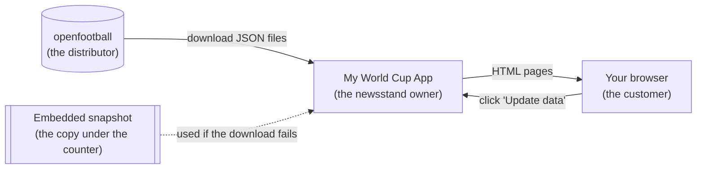

# 1. The big picture

[← Back to the index](README.md) · Next: [Architecture →](02-architecture.md)

## What the app does

My World Cup App is a **website about the FIFA World Cup 2026**. When you open it in a browser you can see:

- the **group tables** (who's leading each group),
- the **knockout bracket** (Round of 32 all the way to the Final),
- **every match** with its result, filterable by round, group, or team,
- **statistics** (top scorers and each team's overall record),
- **links** to official FIFA pages.

## The newsstand analogy

Think of the app as a **newsstand owner**:

1. Every morning (when the app starts) the owner picks up the **latest newspaper** from the distributor — that's the app downloading the match data from the internet ([openfootball/worldcup.json](https://github.com/openfootball/worldcup.json)).
2. The owner **keeps a copy of yesterday's paper under the counter**, just in case the delivery truck doesn't come. That's the **embedded fallback**: a copy of the data baked into the program itself, so the app works even without internet.
3. When a customer asks "who's top of Group A?", the owner **reads the paper and does the math on the spot**. The app never stores the answers — it recalculates tables from match results on every request.
4. If a customer says "is there a newer edition?", the owner **runs to fetch one** — that's the **"Update data"** button.

## What the app does *not* have

| Usually found in web apps | Here | Why |
|---------------------------|------|-----|
| A database | ❌ | All the data fits in memory (~100 matches); it's re-downloaded anyway |
| User accounts / login | ❌ | Everything is public, read-only information |
| A web framework | ❌ | Go's standard library (`net/http`, `html/template`) is enough |
| A JavaScript build step | ❌ | A single small `app.js` file, served as-is |

Fewer moving parts means fewer things that can break — and a much easier codebase to learn from.

## The main ingredients

| Ingredient | Role | Where |
|------------|------|-------|
| **Go** | The programming language of the server | `app/` |
| **HTML templates** | Page "molds" that Go fills with data | `app/web/templates/` |
| **CSS + JavaScript** | Look and feel (dark/light theme, buttons) | `app/web/static/` |
| **Docker** | Packs the app into a portable box | `Dockerfile` |
| **Helm (v4)** | Installs that box on a Kubernetes cluster | `helm/my-world-cup-app/` |
| **mise + Make** | Install the tools and run common commands | `mise.toml`, `Makefile` |

Ready? Let's see [how the code is organized →](02-architecture.md)
