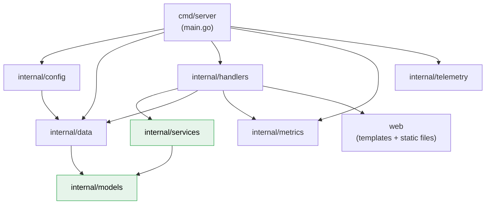

# 2. Architecture

[← The big picture](01-big-picture.md) · Next: [Where the data comes from →](03-data-lifecycle.md)

## The restaurant analogy

The code is organized like a **restaurant**, where each person has exactly one job:

| Restaurant role | Go package | Job |
|-----------------|-----------|-----|
| 🧾 **Waiter** | `internal/handlers` | Takes the customer's order (the HTTP request), brings back the plate (the HTML page). Never cooks. |
| 👩‍🍳 **Chef** | `internal/services` | Does the actual cooking: computes tables, brackets, top scorers. Never talks to customers. |
| 🥕 **Ingredients** | `internal/models` | The raw food items everyone shares: `Team`, `Match`, `Score`, `Standing`... |
| 🚚 **Supplier + pantry** | `internal/data` | Buys ingredients (downloads JSON), cleans them (parses), stores them in the pantry (in-memory `Store`). |
| 📋 **Manager's notebook** | `internal/config` | Reads the restaurant's settings (port, data URLs, timeouts) from environment variables. |
| 📊 **Cash register display** | `internal/metrics` | Counts orders and how long they took, for whoever monitors the restaurant. |
| 🏷️ **Order tickets** | `internal/telemetry` | Staples a numbered ticket to every order (the trace ID) so the notes, the register, and the kitchen timeline can all be matched up later. Also sets up the JSON logger. |
| 🚪 **Opening the doors** | `cmd/server` | `main.go`: hires everyone, unlocks the front door, and closes up politely at night. |
| 🍽️ **Plates and decor** | `web/` | Page templates, CSS, and JavaScript. |

Why split it this way? Because **the chef can be tested without customers**. The `services` functions receive data and return results — no internet, no web server — so a test can simply say "given these 3 matches, the table should look like this".

## Who depends on whom

Arrows mean "uses". Notice that nothing points *back up*: the chef never calls the waiter, and the ingredients don't know about anyone.



The green boxes are **pure**: they never do input/output (no network, no files, no clock). That makes them the easiest part to test and to reason about.

## A tour of the folders

```text
app/
├── cmd/server/main.go        ← the program starts here
├── internal/                 ← "internal" = other Go projects can't import these
│   ├── config/               ← environment variables → Config struct
│   ├── models/               ← Team, Match, Score, Standing, Tournament
│   ├── data/
│   │   ├── client.go         ← downloads the 4 JSON files (in parallel)
│   │   ├── parser.go         ← JSON → models (the "raw*" structs live here only)
│   │   ├── store.go          ← keeps the current data in memory, thread-safely
│   │   ├── fallback.go       ← embeds the offline copy into the binary
│   │   └── fallback/*.json   ← the offline copy itself
│   ├── services/             ← standings, knockout, matches, stats (pure functions)
│   ├── handlers/             ← routes, middleware, page handlers, template helpers, /healthz + /readyz
│   ├── metrics/              ← Prometheus counters and histograms
│   └── telemetry/            ← OpenTelemetry tracing setup + JSON logger with trace IDs
└── web/
    ├── assets.go             ← go:embed: puts templates + static files inside the binary
    ├── templates/*.html      ← one file per page + the shared layout.html
    └── static/{css,js}/      ← style.css and app.js
```

> 💡 **Why is everything inside the binary?** Go's `//go:embed` directive copies files into the compiled program. The result is **one single file** that contains the server, the HTML, the CSS, the JS, *and* a copy of the data. You can copy that file to any machine and run it — no folders to deploy alongside it.

## Design rules worth remembering

1. **Handlers don't do math.** If you catch yourself sorting or adding points inside `handlers/`, move it to `services/`.
2. **Raw JSON stays in `data/`.** The `raw*` structs mirror openfootball's exact JSON shape; everything outside `data/` uses the clean `models` types. If openfootball renames a field, only `parser.go` changes.
3. **Shared data is read-only.** Every request reads the same in-memory `Tournament`. Services must *copy* a slice before sorting it (see `slices.Clone` in `services/matches.go`), or two visitors could scramble each other's view.
4. **Few dependencies, all for observability.** Apart from Go's standard library, the app uses only `prometheus/client_golang` (metrics) and OpenTelemetry (traces). The web part — routing, templates — is 100 % standard library.

Next: [where the data comes from →](03-data-lifecycle.md)
