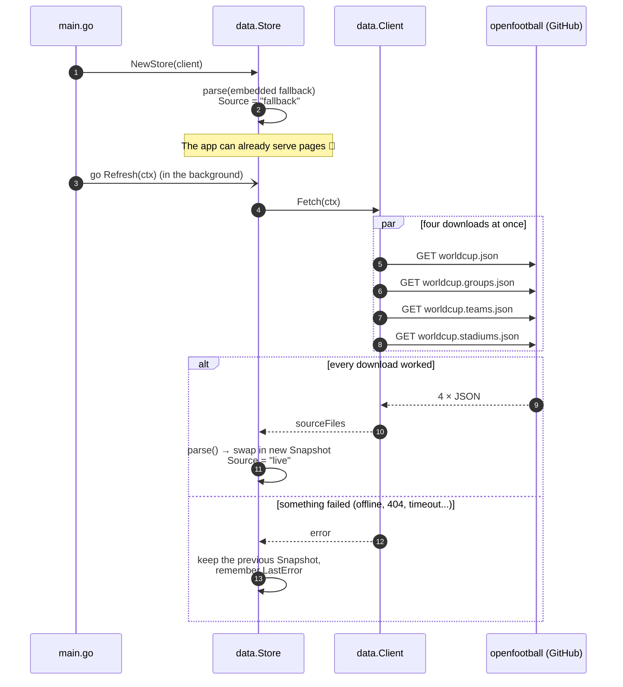

# 3. Where the data comes from

[← Architecture](02-architecture.md) · Next: [Life of a web request →](04-request-lifecycle.md)

## The four source files

All tournament data comes from the open-source project [openfootball/worldcup.json](https://github.com/openfootball/worldcup.json). The app downloads four JSON files:

| File | Contains | Becomes |
|------|----------|---------|
| `worldcup.json` | Every match: teams, date, venue, score, goal scorers | `[]models.Match` |
| `worldcup.groups.json` | Which teams are in which group | `[]models.Group` |
| `worldcup.teams.json` | Team details, including the flag emoji | `[]models.Team` |
| `worldcup.stadiums.json` | Stadiums and host cities | `[]models.Stadium` |

Here's what one match looks like in the raw JSON (a knockout match decided on penalties):

```json
{
  "round": "Round of 32", "num": 74, "date": "2026-06-29",
  "team1": "Germany", "team2": "Paraguay",
  "score": {"p": [3, 4], "et": [1, 1], "ft": [1, 1], "ht": [0, 1]},
  "goals1": [{"name": "Kai Havertz", "minute": "54"}],
  "goals2": [{"name": "Julio Enciso", "minute": "42"}],
  "ground": "Boston (Foxborough)"
}
```

`ht` = half time, `ft` = full time (90 minutes), `et` = after extra time (120 minutes), `p` = penalty shoot-out. A match that hasn't been played yet simply has **no `score` at all**.

## Step 1 — Download (the delivery truck)

`data.Client.Fetch` (`internal/data/client.go`) downloads the four files **at the same time**, like sending four couriers instead of one courier making four trips. It uses `sync.WaitGroup.Go` to start one goroutine (a lightweight thread) per file and wait for all of them.

Safety features:

- **Timeout** — each refresh gives up after `FETCH_TIMEOUT` (default 10 s).
- **Size limit** — each file may be at most 10 MiB, so a broken or malicious server can't fill up the app's memory.
- **Fail together** — if one courier fails, the others are called back (the shared `context` is canceled) and every error is reported together (`errors.Join`).

## Step 2 — Parse (unpacking the groceries)

`parse` (`internal/data/parser.go`) turns JSON bytes into Go structs in two moves:

1. `json.Unmarshal` fills the **`raw*` structs**, which mirror the JSON exactly.
2. The `normalize*` functions copy those into clean **`models`** types — for example a two-number list `[1, 1]` becomes `&models.Score{Home: 1, Away: 1}`, and a missing score stays `nil`.

Think of it as unpacking a grocery delivery: the raw boxes stay in the hallway (`data` package); only neatly labeled jars go into the kitchen (`models`).

## Step 3 — Store (the pantry)

`data.Store` (`internal/data/store.go`) keeps the current data in memory as a `Snapshot`:

```go
type Snapshot struct {
    Tournament  models.Tournament // all teams, groups, matches, stadiums
    LastUpdated time.Time         // when this data was loaded
    Source      string            // "live" or "fallback"
}
```

Many visitors read the pantry at once, but only a refresh writes to it. A **read-write lock** (`sync.RWMutex`) handles this, much like a **library reading room**: any number of people can read at the same time, but when the librarian swaps the newspaper, readers wait a moment so nobody reads half an old page and half a new one.

A second lock (`refreshMu`) ensures **only one refresh runs at a time**. If you click "Update data" while a refresh is already running, you get an *HTTP 429 "Too Many Requests"* answer instead of a duplicate download.

## The whole journey



## The fallback: never an empty page

Because the store is **seeded from the embedded copy before anything else happens**, there is never a moment where the app has no data. The worst case is "slightly outdated data", and the page footer tells you which one you're seeing (`live` or `fallback`).

> 🔧 **Maintainer note:** if openfootball changes its JSON format, update the `raw*` structs in `parser.go` **and** refresh the snapshot in `internal/data/fallback/`, or the offline copy will stop parsing (a test, `TestFallbackSources_ParseSuccessfully`, guards against that).

Next: [life of a web request →](04-request-lifecycle.md)
