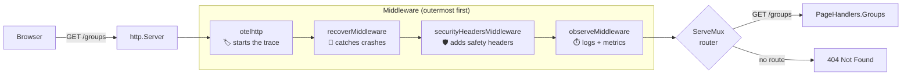
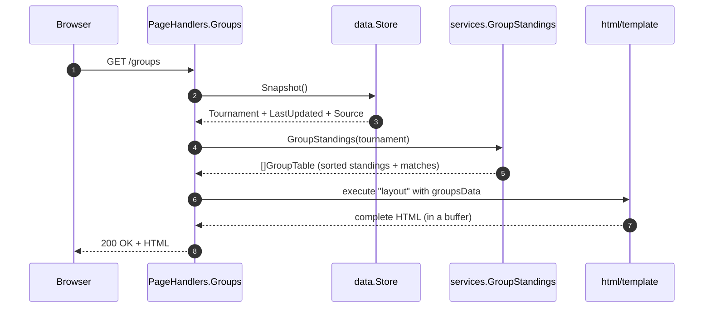
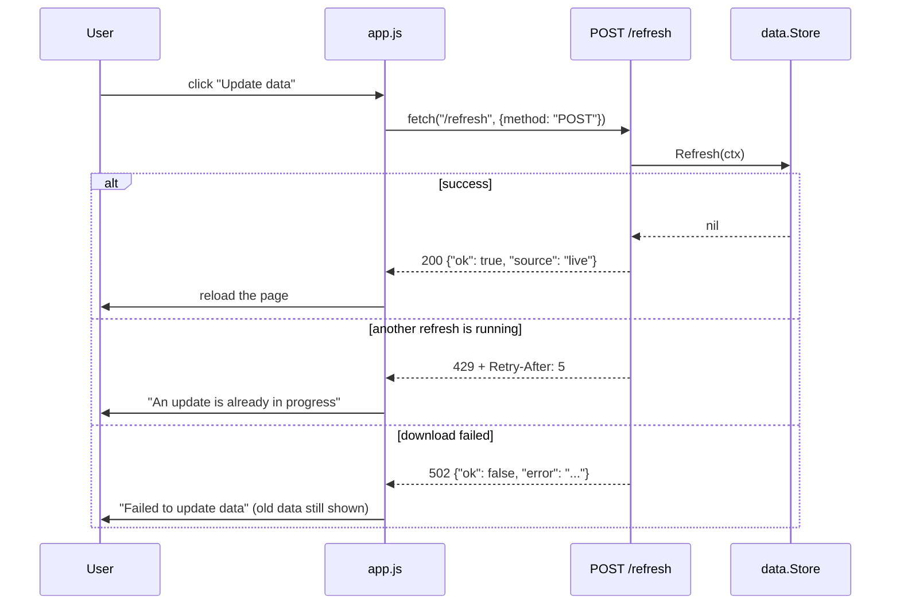

# 4. Life of a web request

[← Where the data comes from](03-data-lifecycle.md) · Next: [Features tour →](05-features.md)

What happens between typing `http://localhost:8080/groups` and seeing the group tables? Let's follow one request.

## The airport analogy

A request travels through the server like a passenger through an **airport**:

1. **Check-in desk** — Go's HTTP server accepts the connection (`http.Server` in `main.go`).
2. **Security checkpoints** — the request passes through layers of **middleware**, each doing one small check or chore.
3. **Departure board** — the **router** (`http.ServeMux`) reads the method and path (`GET /groups`) and sends the passenger to the right gate.
4. **The gate** — the **handler** (`PageHandlers.Groups`) gets the data, asks a service to compute the tables, and renders the page.
5. On the way back, the middleware layers see the response leave (that's how we log the status code and measure the time taken).



### The middleware layers (`internal/handlers/router.go`)

| Layer | Analogy | What it does |
|-------|---------|--------------|
| `otelhttp` (OpenTelemetry) | Luggage tag | Gives the request a trace ID (or reuses one from an incoming `traceparent` header) and records a span for it. A no-op when tracing is off (see [chapter 7](07-observability.md#-traces--following-one-request)) |
| `recoverMiddleware` | Fire extinguisher | If any code panics (crashes), it answers "500 Internal Server Error" instead of killing the whole server |
| `securityHeadersMiddleware` | Security stamp | Adds `X-Content-Type-Options: nosniff`, `X-Frame-Options: DENY`, and `Referrer-Policy` headers that tell browsers to be stricter |
| `observeMiddleware` | Stopwatch + logbook | Times the request, writes a JSON log line (with the trace ID), updates the Prometheus metrics, and renames the span after the route (see [chapter 7](07-observability.md)) |

## Inside the handler

Here's the real `Groups` handler (`internal/handlers/pages.go`), slightly simplified:

```go
func (h *PageHandlers) Groups(w http.ResponseWriter, r *http.Request) {
    snap := h.store.Snapshot()               // 1. take ONE consistent copy of the data
    h.renderer.render(w, "groups", groupsData{
        baseData: newBaseData(snap, "Groups", "groups"), // 2. header/footer info, flags, links
        Tables:   services.GroupStandings(snap.Tournament), // 3. the chef computes the tables
    })                                        // 4. fill the template and send it
}
```

Notice step 1: the handler grabs the snapshot **once** and uses it for everything on the page. If a refresh happens halfway through, this page still shows one consistent version of the data.



## Templates: cookie cutters for HTML

A template is like a **cookie cutter**: the shape (HTML structure) is fixed, the dough (data) changes. Every page has two parts:

- `layout.html` — the shared frame: navigation bar, "Update data" button, theme toggle, footer with "Last updated".
- a page file such as `groups.html` — defines a `{{define "content"}}` block that the layout drops into its middle.

Inside templates, `{{ ... }}` are instructions:

```html
{{range .Standings}}                 <!-- repeat for each row -->
<tr>
  <td>{{flag $.Flags .Team}} {{linked $.TeamLinks .Team}}</td>  <!-- helper functions -->
  <td>{{.Points}}</td>
</tr>
{{end}}
```

The helper functions (`flag`, `linked`, `score`, `result`, `pairs`) live in `templateFuncs` in `internal/handlers/render.go`:

| Helper | Output |
|--------|--------|
| `flag` | The team's flag emoji in a small styled badge |
| `linked` | A link to the official fifa.com page (or plain text if there's none) |
| `score` | A scoreline pill, e.g. `2 - 1` |
| `result` | A match's full outcome: score after extra time, `a.e.t.` marker, penalty score, or a "scheduled" badge |
| `pairs` | Groups bracket matches two by two, for drawing the knockout bracket |

> 🔒 `html/template` automatically **escapes** data, so a team name containing `<script>` would be shown as text, not executed. That's why the project uses it instead of building HTML strings by hand.

The renderer writes the page into a memory buffer first and only sends it when it's complete — if a template fails halfway, the visitor gets a clean error page instead of half a page.

## The "Update data" button

The button is the only JavaScript-driven action (`web/static/js/app.js`):



Next: [a tour of every page →](05-features.md)
