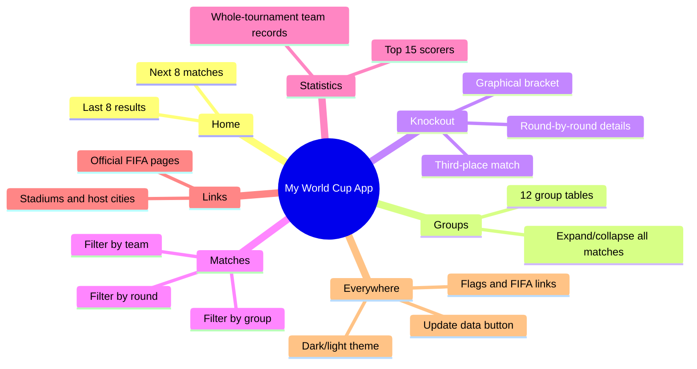
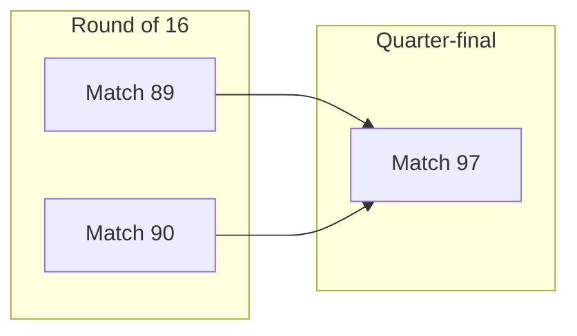

# 5. Features tour

[← Life of a web request](04-request-lifecycle.md) · Next: [Football rules in code →](06-football-rules.md)

Each page follows the same recipe: **route → handler → service(s) → template**. This table is your map:

| Page | Route | Handler (`internal/handlers/pages.go`) | Service(s) (`internal/services/`) | Template (`web/templates/`) |
|------|-------|-----------------------------------------|-----------------------------------|-----------------------------|
| Home | `GET /` | `Home` | `UpcomingMatches`, `RecentResults` | `home.html` |
| Groups | `GET /groups` | `Groups` | `GroupStandings` | `groups.html` |
| Knockout | `GET /knockout` | `Knockout` | `KnockoutStage` | `knockout.html` |
| Matches | `GET /matches` | `Matches` | `AllMatches`, `FilterMatches`, `MatchFilterOptions` | `matches.html` |
| Statistics | `GET /stats` | `Stats` | `TopScorers`, `TeamStandings` | `stats.html` |
| FIFA links | `GET /links` | `Links` | — (static list + stadiums) | `links.html` |



## 🏠 Home (`/`)

A dashboard with the **next 8 unplayed matches** and the **8 most recent results**. `UpcomingMatches` keeps matches without a score and sorts them by date; `RecentResults` keeps played matches, newest first.

## 📊 Groups (`/groups`)

One card per group with the standings table (Played, Won, Drawn, Lost, Goals For/Against, Goal Difference, Points) and a collapsible list of that group's matches. The **"Expand all matches"** button opens or closes every list at once (`initGroupMatchesToggle` in `app.js`). How the table is calculated is explained in [chapter 6](06-football-rules.md).

## 🏆 Knockout (`/knockout`)

Two views of the same data:

1. A **graphical bracket**: one column per round (Round of 32 → Final); winners are highlighted, and matches decided after extra time or on penalties are labeled. The **third-place match** is shown in its own box because it isn't part of the elimination tree.
2. **Match details** tables per round with date, venue, and result.

Both come from one call to `services.KnockoutStage`, so they can never disagree. The handler splits off the third-place round with `splitThirdPlaceRound`, and the `pairs` template helper groups matches two by two so each pair can "feed" the next round's match.



Until a knockout match is decided, openfootball uses **placeholders** like `W74` ("winner of match 74") or `2A` ("runner-up of Group A") instead of team names.

## 📅 Matches (`/matches`)

The full schedule with optional filters, which are plain URL query parameters (so a filtered view can be bookmarked or shared):

```text
/matches?team=Brazil
/matches?round=Final
/matches?group=Group%20C&team=Morocco     ← filters combine with AND
```

`FilterMatches` does case-insensitive comparisons; `MatchFilterOptions` builds the dropdown values (rounds in schedule order, groups and teams alphabetically — placeholders such as `W74` are left out of the team list).

## 📈 Statistics (`/stats`)

- **Top scorers** — the 15 players with the most goals across the whole tournament. Own goals are not credited to the player who scored them ([why](06-football-rules.md#own-goals)).
- **Team overview** — every team's record across group *and* knockout matches, using the same math as the group tables.

## 🔗 FIFA links (`/links`)

A curated list of official FIFA pages plus a table of all 16 stadiums. Across the app, team names, stadiums and host cities link to their fifa.com pages. The slugs (the last part of each URL) come from hand-maintained tables in `internal/handlers/fifa_links.go`, because FIFA's names don't always match openfootball's (e.g. "Turkey" → `turkiye`).

## 🌗 Everywhere

- **Dark/light theme** — `app.js` sets a `data-theme` attribute on the page; `style.css` defines the colors for both themes as CSS variables. Your choice is remembered in the browser's `localStorage` (and the page still works if the browser blocks it).
- **Update data** — see [chapter 4](04-request-lifecycle.md#the-update-data-button).
- **Mobile layout** — below 640 px wide, tables re-stack into cards (the `data-label` attributes on table cells provide the labels).

Next: [the football rules in code →](06-football-rules.md)
