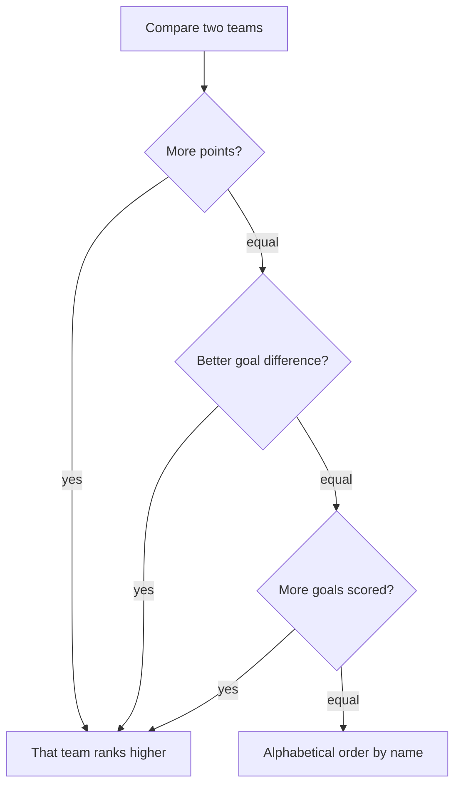
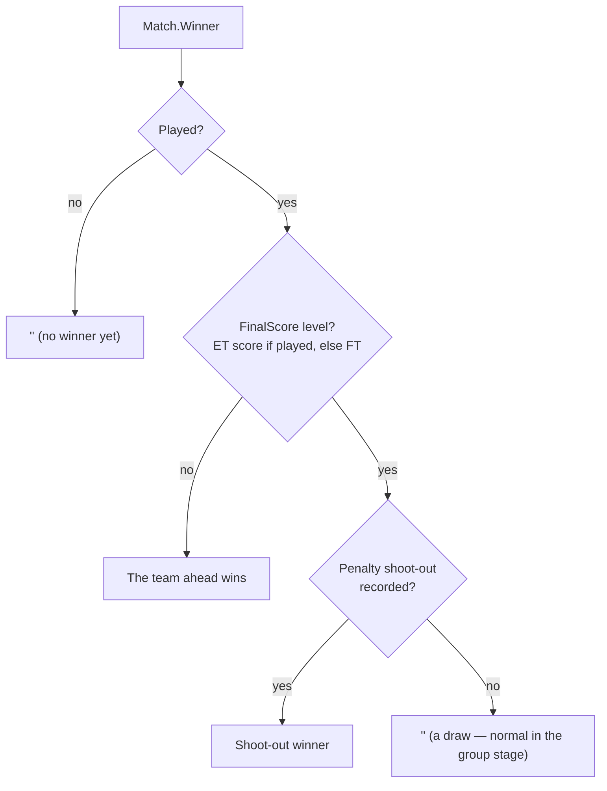

# 6. Football rules in code

[← Features tour](05-features.md) · Next: [Health checks, logs, metrics, and traces →](07-observability.md)

This chapter explains the football logic in `internal/services/` and `internal/models/`. No football knowledge required!

## Points and the group table

Every played match updates both teams' rows (`accumulateResult` in `services/standings.go`):

| Result | Points |
|--------|--------|
| Win | 3 |
| Draw | 1 |
| Loss | 0 |

It also adds goals for (GF), goals against (GA), and recomputes goal difference (GD = GF − GA). **Unplayed matches are skipped** — a match is "played" when it has a full-time score (`Match.Played()`).

> 🧮 **Analogy:** each team has a scorecard. After every match, the referee adds a tally to both cards. The table is just the cards sorted.

## Tie-breaks (who ranks higher?)

When two teams have the same points, the app compares, in order:



In Go this is a single comparison function chained with `cmp.Or` — it returns the first comparison that isn't a tie:

```go
slices.SortFunc(standings, func(a, b models.Standing) int {
    return cmp.Or(
        cmp.Compare(b.Points, a.Points),                 // more points first
        cmp.Compare(b.GoalDifference, a.GoalDifference), // then better GD
        cmp.Compare(b.GoalsFor, a.GoalsFor),             // then more goals
        cmp.Compare(a.Team, b.Team),                     // then A → Z
    )
})
```

⚠️ This is **simplified**: FIFA's real rules first look at head-to-head results between the tied teams, then fair-play points, etc. The page says so, and links to FIFA's official explanation.

## Knockout matches: extra time and penalties

In the knockout stage a match can't end in a draw. If it's level after 90 minutes, 30 minutes of **extra time** are played; if it's *still* level, a **penalty shoot-out** decides.

openfootball records each stage separately, and the extra-time score is **cumulative** (it already includes the first 90 minutes):

```json
"score": {"ft": [1, 1], "et": [2, 1]}             // won 2-1 after extra time
"score": {"ft": [1, 1], "et": [1, 1], "p": [3, 4]} // 1-1 after 120', lost 3-4 on penalties
```

Two methods on `models.Match` turn this into answers:

- `FinalScore()` — the score when play ended: `et` if there was extra time, otherwise `ft`.
- `Winner()` — who advanced:



For **statistics**, goals scored in extra time count (they're real goals), but **shoot-out kicks don't** — a match decided on penalties counts as a draw in the team records, which is also how FIFA's own statistics treat it.

## Own goals

An **own goal** is when a player accidentally scores into their own net. openfootball lists it under the team that *benefits*, with the name of the player who scored it and `"owngoal": true`:

```json
"team1": "Qatar", "team2": "Switzerland",
"goals1": [{"name": "Miro Muheim", "minute": "90+4", "owngoal": true}]
```

Here Miro Muheim plays for **Switzerland**, but the goal counts for **Qatar**. So:

- ✅ it counts in the **score** (Qatar 1),
- ❌ it does **not** count for Miro Muheim in the **top scorers** list — otherwise he'd appear as a Qatar scorer! `TopScorers` skips goals with `OwnGoal == true`, like FIFA's Golden Boot ranking.

## Deterministic ordering

Go deliberately randomizes the order in which you loop over a map. Since tallies are collected in maps, every sort must have a **final tie-break that can never be equal** (team name for tables; player name + team for scorers). Otherwise two players with the same goals could swap places every time you refresh the page. There are tests that sort many times to catch this.

## Where are the tests?

| Rule | Test |
|------|------|
| Points, GD, tie-breaks | `services/standings_test.go` |
| Extra time, penalties | `models/models_test.go`, `services/regression_test.go` |
| Own goals, scorer tie-breaks | `services/regression_test.go` |
| Filtering, placeholders | `services/matches_test.go`, `services/regression_test.go` |

Next: [health checks, logs, metrics, and traces →](07-observability.md)
