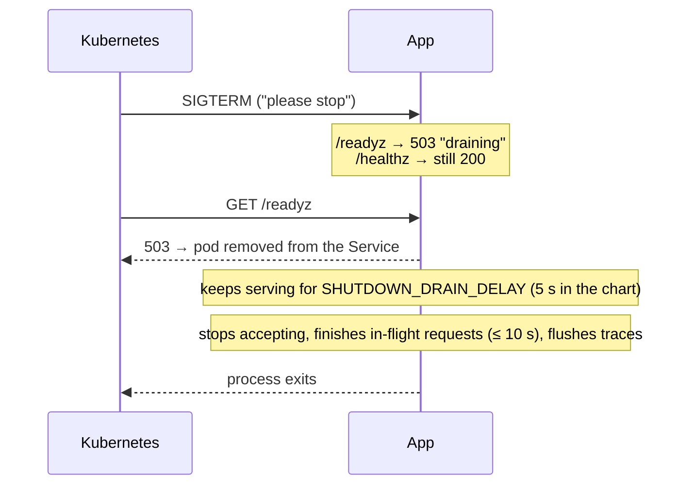
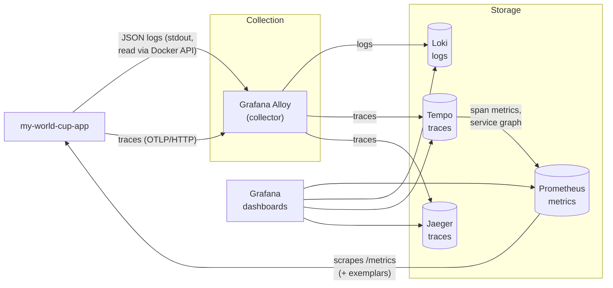
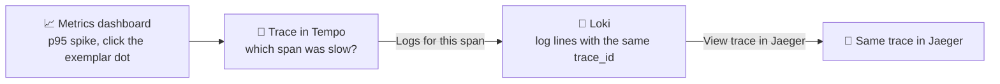

# 7. Health checks, logs, metrics, and traces

[← Football rules in code](06-football-rules.md) · Next: [Running and deploying →](08-running-and-deploying.md)

"Observability" means being able to answer *"is the app OK, and if not, why?"* without attaching a debugger. The app offers four tools for that, which map nicely onto a **hospital patient**:

| Hospital | App | Endpoint / place |
|----------|-----|------------------|
| 💓 Pulse check: "alive?" / "ready for visitors?" | Health checks | `GET /healthz`, `GET /readyz` |
| 📝 Nurse's notes: what happened, when | Logs | standard output (JSON) |
| 📈 Vital-signs monitor: numbers over time | Metrics | `GET /metrics` |
| 🩻 The patient's path through the hospital: reception → X-ray → lab, with times | Traces | sent to a collector (OpenTelemetry) |

The magic ingredient that connects the last three is the **trace ID**: one random identifier per request, written on the nurse's notes, attached to the vital-signs readings, and printed on the patient's wristband.

## 💓 Health checks — `/healthz` and `/readyz`

Two questions sound alike but must be answered separately:

| Endpoint | Question | Answer | Who asks |
|----------|----------|--------|----------|
| `/healthz` (**liveness**) | "Is the process alive?" | Always `200 ok` while the server can answer | Docker `HEALTHCHECK`; Kubernetes startup + liveness probes. Failing → **restart** the container |
| `/readyz` (**readiness**) | "Should I get new visitors?" | `200` normally; `503` once shutdown has begun | Kubernetes readiness probe. Failing → **stop sending traffic** (no restart) |

**Analogy:** a shop at closing time. It's still *alive* (lights on, staff inside, customers finishing their purchases), but the sign on the door flips to *closed* (not *ready*) so no new customers walk in.



`/readyz` also tells you which data the app is serving:

```json
{"status":"ready","data_source":"live","last_updated":"2026-11-16T09:40:37Z"}
```

Why doesn't readiness fail when openfootball is down? Because the app still has the embedded fallback data to show. If every copy of the app declared itself "not ready" at the same moment, the whole site would go offline instead of showing slightly old data.

The Docker image has no shell and no `curl` (it's a minimal "distroless" image), so the binary checks itself: `/app/server -healthcheck` calls its own `/healthz` and exits with code 0 (healthy) or 1 (unhealthy).

## 📝 Logs — JSON lines

The app uses Go's structured logger, `log/slog`, and by default writes **one JSON object per line** to standard output. Every request produces one "access log" line:

```json
{"time":"2026-11-16T09:45:39.67Z","level":"INFO","msg":"request","method":"GET","path":"/stats","route":"/stats","status":200,"duration_ms":0.9,"trace_id":"f448a12c43a019a26ab99c77134820d1","span_id":"68a87468c4881c30"}
```

**Why JSON?** For a human, `GET /stats 200 0.9ms` is easier to read. For a program, JSON is unambiguous: every value has a name, so a log system can answer questions like *"p95 `duration_ms` of `route=/stats` in the last hour"* without fragile text parsing. Think of it as a **form with labeled boxes** instead of a handwritten note.

Prefer reading text in your terminal? `LOG_FORMAT=text make run` prints the same fields as `key=value` pairs.

| Field | Meaning |
|-------|---------|
| `time`, `level`, `msg` | When, how serious (`DEBUG` < `INFO` < `WARN` < `ERROR`), and what happened |
| `method`, `path`, `route`, `status`, `duration_ms` | The request: `route` is the matched pattern (`unmatched` for unknown URLs) |
| `trace_id`, `span_id` | Which trace this line belongs to (only when there is one) |

Other notable messages:

| `msg` | Level | Meaning |
|-------|-------|---------|
| `server starting` | INFO | The server is listening (also logs `version` and whether `tracing` is on) |
| `data refreshed from live source` | INFO | A refresh succeeded (`matches=104`) |
| `data refresh failed, keeping previous snapshot` | WARN | Download/parse failed; the old data stays |
| `panic recovered` | ERROR | A bug crashed a handler; the visitor got a 500 page, the server kept running |
| `draining before shutdown` | INFO | SIGTERM received, `/readyz` is 503, waiting `SHUTDOWN_DRAIN_DELAY` |
| `shutting down server` | INFO | Finishing in-flight requests (up to 10 s) |

See them with `make run` (in your terminal), `make docker-logs`, `kubectl logs deploy/my-world-cup-app -n my-world-cup-app`, or the **Logs** dashboard in Grafana.

> Code: the logger is built by `telemetry.NewLogger` (`internal/telemetry/log.go`). It wraps slog's JSON handler and adds `trace_id`/`span_id` whenever a log call receives a context containing a span — that's why the code uses `slog.InfoContext(ctx, ...)` instead of `slog.Info(...)` wherever a request context exists.

## 📈 Metrics — `/metrics`

The app speaks the [Prometheus](https://prometheus.io/) format. Prometheus is a program that **visits `/metrics` every few seconds** and stores the numbers, so you can graph them (e.g. in Grafana) and set alerts.

| Metric | Type | Meaning |
|--------|------|---------|
| `http_requests_total{method, path, status}` | counter | How many requests, by route and status class (`2xx`, `4xx`, ...) |
| `http_request_duration_seconds{method, path}` | histogram | How long requests took |
| `data_refresh_total{outcome}` | counter | Refresh attempts, `success` or `failure` |
| `data_last_refresh_timestamp_seconds` | gauge | When the last successful refresh happened (Unix time) |

A **counter** only goes up (like a car's odometer); a **gauge** goes up and down (like a speedometer); a **histogram** sorts measurements into buckets (like counting how many runners finished under 1 h, under 2 h, ...).

### Why `path` is the route, not the URL

The `path` label is the **route pattern** (`/groups`, `/static/`), never the raw URL. Every distinct label value creates a new time series in Prometheus, and the internet is full of bots probing random URLs like `/wp-admin/setup.php`. If each one became a label, Prometheus' memory would grow without limit. So requests that match no route are all recorded as `path="unmatched"`.

### Exemplars: from a number to a request

A latency graph tells you *"p95 jumped to 800 ms at 14:02"*, but not *which* request was slow. An **exemplar** is a sample request pinned to the graph, carrying its trace ID — like a teacher's grade chart with a sticky note *"see Ana's exam"* on the worst point. In Grafana they appear as dots; clicking one opens the trace.

Exemplars travel only in the newer *OpenMetrics* text format, which Prometheus requests automatically.

> Instrumentation lives in `internal/metrics/metrics.go`, using a **dedicated registry** (not Prometheus' global default), and is wired in by `observeMiddleware`. If you add another way to trigger a refresh, call `metrics.RecordRefresh(err)` there too.

In Kubernetes, the chart adds `prometheus.io/scrape: "true"` (plus port and path) annotations to the pod so a cluster Prometheus can discover it automatically.

## 🩻 Traces — following one request

A **trace** is the full story of one request; each step in it is a **span** with a start time and a duration. **Analogy:** a parcel's tracking page — *"picked up 09:00 → sorting center 11:30 → out for delivery 14:10"*. If the parcel is late, you see exactly which leg took long.

For a click on **Update data**, the trace looks like this:

```mermaid
gantt
    title One POST /refresh trace (times in ms)
    dateFormat x
    axisFormat %L
    section app
    POST /refresh (server span)      :0, 224
    data.Refresh                     :2, 220
    section openfootball
    HTTP GET worldcup.json           :3, 210
    HTTP GET worldcup.groups.json    :3, 120
    HTTP GET worldcup.teams.json     :3, 140
    HTTP GET worldcup.stadiums.json  :3, 95
```



You can *see* that the four downloads run in parallel, and that `worldcup.json` is the slow one.

How it works:

- The app uses [OpenTelemetry](https://opentelemetry.io/) (`internal/telemetry`), the vendor-neutral standard for traces.
- `otelhttp` wraps the router (one server span per request, renamed to the route, e.g. `GET /groups`) and the HTTP client (one client span per download). `/healthz`, `/readyz`, and `/metrics` are not traced — they're called every few seconds and would bury real traffic.
- Spans are sent over **OTLP** (the OpenTelemetry protocol) to the address in `OTEL_EXPORTER_OTLP_ENDPOINT`. **No endpoint, no tracing:** the app then uses a do-nothing tracer that costs almost nothing.
- The trace ID is also handed to the logger (→ `trace_id` in logs) and to the metrics (→ exemplars). That's the thread tying the three signals together.

## 🔭 Seeing it all: the local observability stack

`make observability-up` starts the app plus six containers (see `docker-compose.observability.yml` and the `observability/` folder):



**Analogy:** Alloy is the **mail room**: it collects envelopes (logs, traces) from every office and drops each into the right archive. Prometheus, Loki, Tempo, and Jaeger are the **archives**, each specialized in one kind of document. Grafana is the **reading room** where you look at everything side by side.

| Open | URL | What for |
|------|-----|----------|
| Grafana | <http://localhost:3000> | The three dashboards + *Explore* (no login needed) |
| Jaeger UI | <http://localhost:16686> | Search and compare traces |
| Prometheus | <http://localhost:9090> | Raw PromQL queries, scrape targets |
| Alloy | <http://localhost:12345> | Pipeline graph of the collector (debugging) |

Port already in use? `make observability-up GRAFANA_PORT=13000` (also `PROMETHEUS_PORT`, `LOKI_PORT`, `TEMPO_PORT`, `JAEGER_PORT`, `ALLOY_PORT`). Everything listens on `127.0.0.1` only, because Grafana runs without a login.

### The dashboards (folder "My World Cup App")

| Dashboard | Shows | Try this |
|-----------|-------|----------|
| **Metrics** | Request rate, 5xx ratio, latency percentiles, traffic per route, refresh health, span metrics from Tempo | Click a dot on *Latency percentiles* → jumps to that request's trace |
| **Logs** | Log volume by level, statuses and p95 duration computed *from the JSON logs*, the live log stream, warnings/errors, the stack's own logs | Expand a log line → **View trace in Tempo** / **in Jaeger** |
| **Traces** | RED metrics (Rate, Errors, Duration) from spans, the service graph, tables of recent / slow / failed / refresh traces | Open a `data.Refresh` trace → see the four parallel downloads; click **Logs for this span** |

### Following one slow request across the three signals



> Grafana and Jaeger: Jaeger 2.21+ removed an old HTTP API that Grafana's Jaeger plugin still uses to *search* traces. Opening a trace by ID works (that's what the log links do); for searching, use the Jaeger UI.

Next: [running and deploying →](08-running-and-deploying.md)
