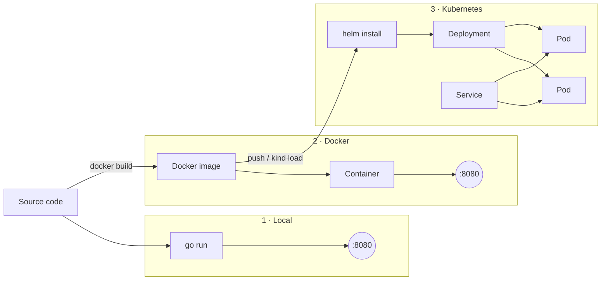
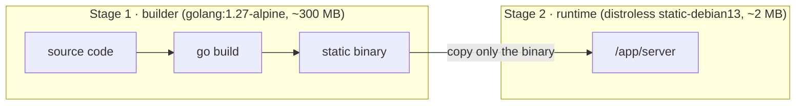

# 8. Running and deploying

[← Health checks, logs, metrics, and traces](07-observability.md) · Next: [Developer workflow →](09-dev-workflow.md)

There are three ways to run the app, from simplest to most "production-like". Make sure you've installed the tools first ([REQUIREMENTS.md](../REQUIREMENTS.md)).



## 1 · Local — `make run`

```bash
make run              # same as: PORT=8080 go -C app run ./cmd/server
```

Open <http://localhost:8080>. Stop with **Ctrl+C** — the app finishes in-flight requests before exiting ("graceful shutdown").

`make build` instead produces a single file, `bin/my-world-cup-app`, that you can copy anywhere and run.

### Configuration

Everything is configured through **environment variables**, all optional:

| Variable | Default | Meaning |
|----------|---------|---------|
| `PORT` | `8080` | Port to listen on |
| `FETCH_TIMEOUT` | `10s` | Max time for one data refresh (Go duration: `500ms`, `15s`, `1m`) |
| `LOG_FORMAT` | `json` | `json` for log collectors, `text` for reading in a terminal |
| `SHUTDOWN_DRAIN_DELAY` | `0s` | On shutdown, keep serving this long while `/readyz` says 503 (the Helm chart uses `5s`) |
| `OTEL_EXPORTER_OTLP_ENDPOINT` | *(unset)* | Where to send traces, e.g. `http://localhost:4318`; unset = tracing off |
| `OTEL_SERVICE_NAME` | `my-world-cup-app` | Name shown in the tracing tools (any other standard `OTEL_*` variable works too) |
| `WORLDCUP_MATCHES_URL` | openfootball | Where to download matches from |
| `WORLDCUP_GROUPS_URL` | openfootball | ... groups |
| `WORLDCUP_TEAMS_URL` | openfootball | ... teams |
| `WORLDCUP_STADIUMS_URL` | openfootball | ... stadiums |

```bash
PORT=9000 FETCH_TIMEOUT=30s LOG_FORMAT=text make run
```

## 2 · Docker — `make docker-up`

**Analogy:** a Docker image is a **lunchbox**: the app plus everything it needs, sealed, so it tastes the same on any table (your laptop, a server, a colleague's Mac).

```bash
make docker-up      # build the image and start it in the background
make docker-logs    # follow the logs
make docker-down    # stop and remove it
```

How the image is built (`Dockerfile`) — a **two-stage** build:



The first stage is a full workshop with the Go compiler; the second is an almost empty box that only receives the finished product. The final image has no shell, no package manager, runs as a non-root user (UID 65532) — little for an attacker to use.

**With dashboards:** `make observability-up` starts the same container *plus* Grafana, Prometheus, Loki, Tempo, Jaeger, and Alloy, already wired together — see [chapter 7](07-observability.md#-seeing-it-all-the-local-observability-stack). `make observability-down` stops it all.

**Multi-architecture:** `make docker-build-multiarch` builds for both `linux/amd64` (Intel/AMD PCs and servers) and `linux/arm64` (Apple Silicon Macs, AWS Graviton). Go cross-compiles natively, so no slow CPU emulation is needed. `make docker-push` publishes such an image to a registry (it asks for your credentials interactively).

## 3 · Kubernetes with Helm 4

**Analogy:** if Docker is a lunchbox, **Kubernetes** is a **cafeteria manager** that keeps the right number of lunchboxes out, replaces any that go bad, and routes hungry people to them. **Helm** is the **recipe card** you hand the manager: "run this image, this many copies, with these settings".

> ⚠️ The chart requires **Helm 4**. With Helm 3 it stops with `chart my-world-cup-app requires Helm 4`. `make install-deps` installs the right version via mise.

The chart (`helm/my-world-cup-app/`) creates:

| Kubernetes object | Role |
|-------------------|------|
| `Deployment` | Runs N copies (pods) of the container and replaces failed ones |
| `Service` | A stable internal address that load-balances across the pods |
| `ServiceAccount` | The pod's identity (its API token is **not** mounted — the app doesn't need it) |
| `Ingress` *(optional)* | Exposes the app on a public hostname |
| `HorizontalPodAutoscaler` *(optional)* | Adds/removes pods based on CPU usage |

Kubernetes keeps an eye on each pod with three **probes** (see [chapter 7](07-observability.md#-health-checks--healthz-and-readyz)):

| Probe | Endpoint | If it fails... |
|-------|----------|----------------|
| `startupProbe` | `/healthz` | ...for 30 s after start, the container is restarted (until it passes, the other probes wait) |
| `livenessProbe` | `/healthz` | ...3 times in a row, the container is restarted |
| `readinessProbe` | `/readyz` | ...the pod stops receiving traffic (this is what happens during a graceful shutdown) |

The chart also sets `SHUTDOWN_DRAIN_DELAY=5s` and `LOG_FORMAT=json`. To send traces to a collector in your cluster, uncomment the `OTEL_*` entries under `env` in `values.yaml`.

### Try it on your laptop with kind

[kind](https://kind.sigs.k8s.io/) runs a whole Kubernetes cluster inside Docker containers.

```bash
kind create cluster --name kind-multinodes              # once
make kind-load                                          # build the image and copy it into the cluster
make helm-install                                       # helm upgrade --install ... --wait
kubectl port-forward svc/my-world-cup-app 8080:8080 -n my-world-cup-app
```

Open <http://localhost:8080>. Remove everything with `make helm-uninstall`.

### Checking the chart without a cluster

```bash
make helm-lint       # static checks (default values + optional templates enabled)
make helm-template   # print the YAML that would be applied
```

Chart settings are in `helm/my-world-cup-app/values.yaml`; every option is documented in the generated [chart README](../helm/my-world-cup-app/README.md).

## Versions

The root `VERSION` file holds the app version (e.g. `1.4.0`). It's used as the Docker image tag and copied into the chart's `appVersion` by `make helm-sync-version`. See [CONTRIBUTING.md](../CONTRIBUTING.md) for when to bump it.

Next: [developer workflow →](09-dev-workflow.md)
