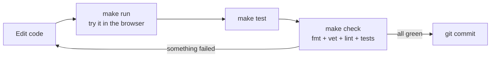
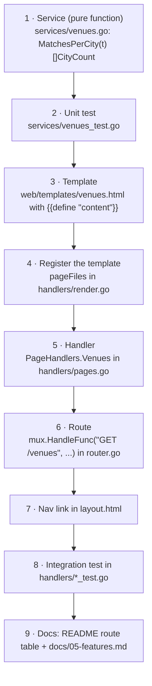

# 9. Developer workflow

[← Running and deploying](08-running-and-deploying.md) · [Glossary →](glossary.md)

## Your toolbox: mise + Make

- **[mise](https://mise.jdx.dev)** is a **tool librarian**: `mise.toml` lists the exact versions of Go, golangci-lint, Helm, helm-docs, kind, and kubectl this project uses, and mise installs and switches to them automatically inside this folder. Everyone on the team gets the same versions.
- **Make** is a **remote control**: `make <button>` runs a longer command for you. `make help` lists every button.

```bash
make install-deps   # first time only: install everything (except Docker)
make check-deps     # "is everything installed?"
make help           # list all targets
```

You don't even need to activate mise in your shell: the Makefile runs every tool through `mise exec`.

## The daily loop



| Command | What it checks |
|---------|----------------|
| `make fmt` | Rewrites the code in the standard Go format (`gofmt`) |
| `make vet` | `go vet`: suspicious constructs the compiler allows (wrong `Printf` args, ...) |
| `make lint` | `golangci-lint` with ~15 linters, including **`modernize`** (flags old-style Go that has a newer idiom) and **`gosec`** (security) |
| `make test` | All unit and integration tests |
| `make test-coverage` | Tests + which lines they exercise |
| `make check` | All of the above (except coverage) — **run this before every commit** |

## Kinds of tests

| Package | Style | Example |
|---------|-------|---------|
| `models`, `services` | **Pure unit tests** with hand-built data — fast, no network | "Given a 2-1 win after extra time, Alpha gets 3 points" |
| `data` | Uses `httptest.NewServer`, a fake web server living inside the test | "If the matches file returns 404, keep the old data" |
| `handlers` | **Integration tests**: the real router + the embedded data, checking the HTML | "The knockout page links Mexico City to its FIFA page" |

Tests cannot click buttons or check CSS layout (there's no browser in the test suite). If you change `style.css` or `app.js`, check the result manually in a browser.

## Writing modern Go

The project targets **Go 1.27** and follows the [JetBrains Modern Go Guidelines](https://github.com/JetBrains/go-modern-guidelines). A few idioms you'll see:

| Instead of... | We write... | Since |
|---------------|-------------|-------|
| `sort.Slice(s, func(i, j int) bool {...})` | `slices.SortFunc(s, func(a, b T) int { return cmp.Compare(...) })` | Go 1.21 |
| `if a == "" { a = b }` | `a = cmp.Or(a, b)` | Go 1.22 |
| `if x > n { x = n }` | `x = min(x, n)` | Go 1.21 |
| `wg.Add(1); go func(){ defer wg.Done(); ... }()` | `wg.Go(func(){ ... })` | Go 1.25 |
| `ctx := context.Background()` in tests | `ctx := t.Context()` | Go 1.24 |
| `s := Score{...}; p := &s` | `p := new(Score{...})` | Go 1.26 |
| loop collecting map keys, then sort | `slices.Sorted(maps.Keys(m))` | Go 1.23 |
| `err == target` | `errors.Is(err, target)` | Go 1.13 |

`make lint` catches many of these automatically through the `modernize` analyzer.

## Step by step: adding a new page

Say you want a `/venues` page listing how many matches each host city hosts.



1. **Service** — write `MatchesPerCity(t models.Tournament) []CityCount` in `internal/services/`. No HTTP, no I/O; don't sort `t.Matches` in place (clone first).
2. **Unit test** — build a tiny `models.Tournament` by hand and check the output.
3. **Template** — create `web/templates/venues.html` with `{{define "content"}} ... {{end}}`. Wrap tables in `<div class="table-responsive">`, render cities with `{{linked $.CityLinks .City}}`.
4. **Register** it in `pageFiles` (`internal/handlers/render.go`).
5. **Handler** — in `pages.go`: take `snap := h.store.Snapshot()`, call your service, render with `newBaseData(snap, "Venues", "venues")`.
6. **Route** — `mux.HandleFunc("GET /venues", pages.Venues)` in `router.go`.
7. **Navigation** — add a link in `layout.html`.
8. **Integration test** — request `/venues` through `newTestRouter(t)` and assert on the HTML.
9. **Docs** — add the route to `README.md` and this guide.

Then `make check`, and follow [CONTRIBUTING.md](../CONTRIBUTING.md) to open a pull request.

[Glossary →](glossary.md)
